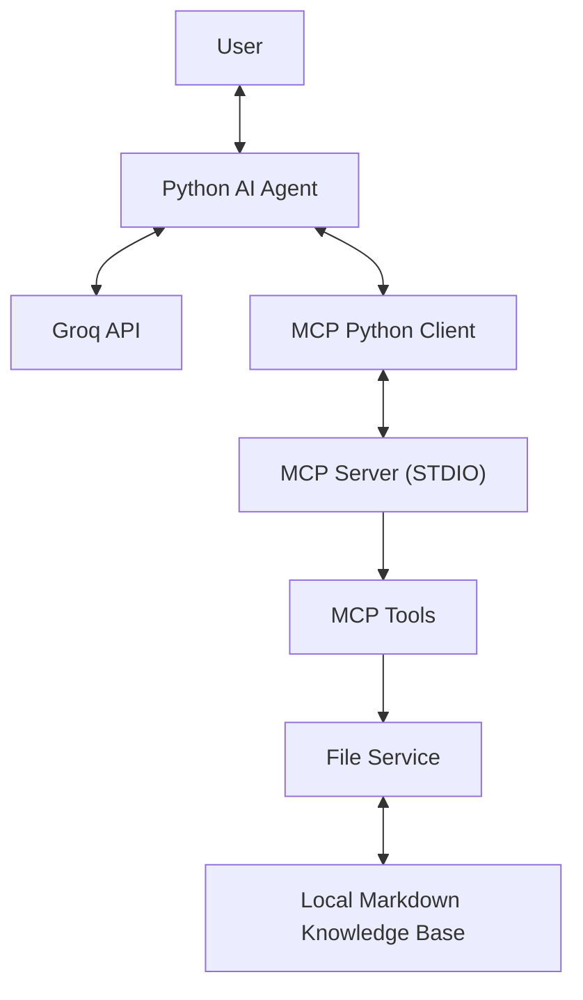

# Personal Knowledge Base MCP Agent

A Python-based personal knowledge management system built with the **Model Context Protocol (MCP)** and a **Groq-powered AI agent**. It allows an AI agent to search, read, and create Markdown notes stored in a local knowledge base through dedicated MCP tools.

## Overview

This project demonstrates how to connect an LLM-powered agent to local files through the Model Context Protocol.

Instead of giving the language model direct filesystem access, the application exposes controlled operations through an MCP server. The AI agent selects the appropriate tool based on the user's request, executes it through an MCP client, and uses the returned information to formulate a response.

## Features

- **Search notes:** Case-insensitive keyword search across Markdown files, including nested directories.
- **Read notes:** Retrieve the complete contents of an existing Markdown note.
- **Create notes:** Create new Markdown notes, including nested directories.
- **AI tool selection:** Groq-powered agent selects MCP tools based on the user's request.
- **Input validation:** Validate note paths, search queries, and note content.
- **Filesystem safeguards:** Protect against path traversal and symlink-based directory escapes.
- **File-size limits:** Enforce configurable limits on file reads and writes.
- **Automated testing:** Unit and MCP integration tests using pytest.

## Architecture



### Request flow

1. The user submits a natural-language request.
2. The Python agent sends the request and available tool definitions to the Groq API.
3. The model selects an appropriate tool and provides its arguments.
4. The MCP client invokes the corresponding tool on the MCP server.
5. The server validates the input and delegates the operation to the file service.
6. The result is returned to the agent through the MCP client.
7. The agent provides a final response to the user.

## Technology Stack

| Component | Technology |
|---|---|
| Programming language | Python 3.12+ |
| AI model API | Groq API |
| Default model | `openai/gpt-oss-20b` |
| Agent tool calling | Groq Chat Completions |
| Tool integration | MCP Python SDK |
| Data format | Markdown |
| Validation | Pydantic |
| Configuration | python-dotenv |
| Package and environment management | uv |
| Testing | pytest, pytest-asyncio |

## Available MCP Tools

| Tool | Description |
|---|---|
| `search_notes` | Searches Markdown notes using case-insensitive keyword matching. |
| `read_note` | Reads the complete contents of a specified note. |
| `write_note` | Creates a new Markdown note. Rejects an existing destination rather than overwriting it. |

**Search limitation:** The current implementation uses keyword-based text matching. It does not implement vector embeddings, semantic search, or Retrieval-Augmented Generation (RAG).

## Project Structure

```text
personal-knowledge-mcp/
│
├── src/
│   └── knowledge_mcp/
│       ├── __init__.py
│       ├── config.py
│       ├── server.py
│       ├── tools/
│       │   ├── __init__.py
│       │   ├── read.py
│       │   ├── search.py
│       │   └── write.py
│       ├── services/
│       │   ├── __init__.py
│       │   └── file_service.py
│       └── validators/
│           ├── __init__.py
│           └── input_validator.py
│
├── client/
│   ├── __init__.py
│   ├── ai_agent.py
│   └── mcp_client.py
│
├── scripts/
│   └── check_groq_connection.py
│
├── tests/
│   ├── __init__.py
│   ├── conftest.py
│   ├── evaluate_agent.py
│   ├── test_file_service.py
│   ├── test_mcp_integration.py
│   └── test_validators.py
│
├── knowledge_base/       # Local data; excluded from Git
│
├── .env.example
├── .gitignore
├── pyproject.toml
├── uv.lock
└── README.md
```

## Getting Started

### Prerequisites

- Python 3.12 or later
- [uv](https://docs.astral.sh/uv/)
- A Groq API key

### 1. Clone the repository

```bash
git clone https://github.com/YOUR_USERNAME/personal-knowledge-mcp.git
cd personal-knowledge-mcp
```

### 2. Install dependencies

```bash
uv sync --dev
```

### 3. Configure environment variables

Create your local environment file from the example:

**Windows PowerShell**

```powershell
Copy-Item .env.example .env
```

**Linux/macOS**

```bash
cp .env.example .env
```

Edit `.env` and provide your Groq API key:

```env
GROQ_API_KEY=your_groq_api_key
GROQ_MODEL=openai/gpt-oss-20b

KNOWLEDGE_BASE_PATH=knowledge_base

MAX_FILE_SIZE=1048576
MAX_QUERY_LENGTH=500
```

Never commit your `.env` file or expose your API key.

### 4. Create your local knowledge base

Create the directory structure:

```text
knowledge_base/
├── learning/
├── projects/
├── python/
└── research/
```

Add your own Markdown (`.md`) notes to these directories. The knowledge base is local application data and is excluded from the public Git repository.

### 5. Run the AI agent

```bash
uv run python -m client.ai_agent
```

The agent connects to the local MCP server using STDIO transport and uses the configured Groq model for tool selection.

## Example Requests

Once the agent is running, try requests such as:

```text
Search my notes for Python memory management.

Find my pothole detection research note and read its full contents.

Create a new note named learning/mcp_concepts.md
with an explanation of MCP resources and tools.
```

The agent determines which available MCP tool is appropriate for each request.

## Testing

Run the automated test suite:

```bash
uv run pytest tests/ -v
```

The test suite covers:

- Note reading, searching, and writing.
- Nested directory handling.
- Invalid paths and path traversal attempts.
- Symlink escape protection.
- File-size and input validation.
- MCP server tool integration.

### Agent evaluation

Run the separate LLM agent evaluation:

```bash
uv run python -m tests.evaluate_agent
```

The evaluation uses predefined scenarios to assess:

- First tool selection.
- Tool-call sequence.
- Tool execution.
- Task completion.
- Tool-call efficiency.

**Latest recorded evaluation:** 10 out of 10 predefined scenarios passed (100% on that evaluation run).

This result describes the tested scenarios and is not a guarantee of general-purpose agent accuracy or production reliability.

## Configuration

The application supports the following environment variables:

| Variable | Description | Default |
|---|---|---|
| `GROQ_API_KEY` | Groq API authentication key | Required |
| `GROQ_MODEL` | Groq model identifier | `openai/gpt-oss-20b` |
| `KNOWLEDGE_BASE_PATH` | Local knowledge-base directory | `knowledge_base` |
| `MAX_FILE_SIZE` | Maximum file size in bytes | `1048576` |
| `MAX_QUERY_LENGTH` | Maximum search query length | `500` |

## Security Considerations

- API credentials are loaded from environment variables.
- The `.env` file is excluded from version control.
- Note paths are validated before filesystem operations.
- Path traversal attempts are rejected.
- Symlink-based escapes are guarded against.
- File-size limits help prevent unexpectedly large file operations.
- The MCP-facing note creation tool rejects existing destinations instead of overwriting them.

These safeguards reduce common filesystem risks but should not be interpreted as a complete security audit or production security certification.

## Current Limitations

- Search uses literal keyword matching rather than semantic retrieval.
- Notes are stored as local Markdown files.
- The application currently uses a single configured Groq model.
- The MCP server communicates with the local client using STDIO.
- The current wheel packages the `knowledge_mcp` server library; the complete agent is run from the cloned source repository.

## Future Improvements

- Semantic search using embeddings.
- Vector database integration.
- Retrieval-Augmented Generation (RAG).
- Note metadata and tagging.
- Improved agent evaluation with larger and more diverse test sets.
- Additional MCP resources and prompts.
- Support for additional LLM providers.

## License

Choose and add an open-source license before publishing if you intend to allow reuse. No license is currently specified.
